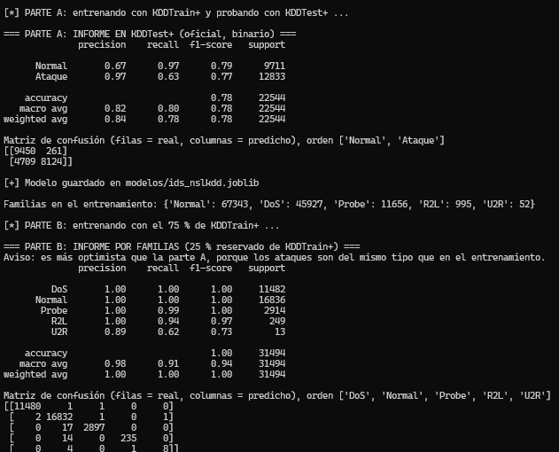
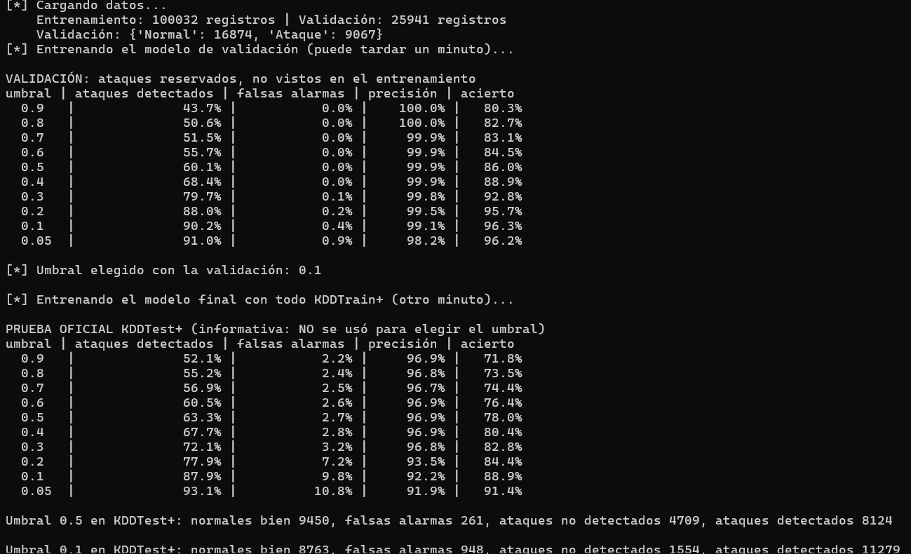
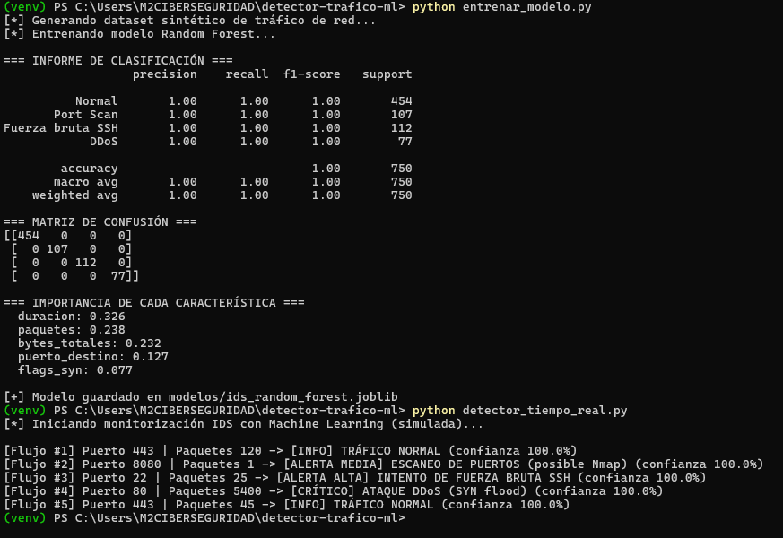

## Detector de intrusiones de red con Machine Learning

Prototipo de sistema de detección de intrusiones (NIDS) en Python con un clasificador Random Forest. Tiene dos partes:

1. **Evaluación con datos reales (NSL-KDD):** entrena y mide el modelo con un conjunto de datos de referencia para la detección de intrusiones.
2. **Demo sintética:** flujo completo con datos inventados (entrenar, guardar y clasificar flujos simulados), útil para ver el funcionamiento de principio a fin.

## Resultados con datos reales (NSL-KDD)

### Medición oficial: entrena con `KDDTrain+`, prueba con `KDDTest+`

Clasificación binaria (Normal / Ataque), 125.973 registros de entrenamiento y 22.544 de prueba.

| Clase | Precisión | Recall | Registros |
|---|---|---|---|
| Normal | 0,67 | 0,97 | 9.711 |
| Ataque | 0,97 | 0,63 | 12.833 |
| **Acierto global** | | **0,78** | 22.544 |

Matriz de confusión (filas = real, columnas = predicho):

| | Predicho Normal | Predicho Ataque |
|---|---|---|
| **Real Normal** | 9.450 | 261 |
| **Real Ataque** | 4.709 | 8.124 |

**Lectura:** el modelo da pocas falsas alarmas (261 de 9.711, un 2,7 %), pero **no detecta el 37 % de los ataques** (4.709 de 12.833). En un sistema de detección de intrusiones, los ataques no detectados son el error más costoso. Una posible causa es que el conjunto de prueba incluye tipos de ataque ausentes en el de entrenamiento; no se ha verificado en este proyecto.



### Medición por familias de ataque (más optimista)

Se reserva el 25 % de `KDDTrain+` (31.494 registros) y se entrena con el resto. Como los ataques de validación son del mismo tipo que los de entrenamiento, **estos resultados son más optimistas que los de la medición oficial**.

| Familia | Recall | Observación |
|---|---|---|
| Normal | ~1,00 | |
| DoS | ~1,00 | |
| Probe | 0,99 | |
| R2L | 0,94 | 235 de 249 |
| U2R | 0,62 | solo 13 casos en validación (52 en entrenamiento): cifra poco fiable |

## Ajuste del umbral de decisión

Por defecto el modelo marca "ataque" si está al menos un 50 % seguro. Bajar ese umbral detecta más ataques a cambio de más falsas alarmas. El umbral se eligió **sin mirar `KDDTest+`**:

1. Se reservan cinco tipos de ataque (`ipsweep`, `teardrop`, `warezclient`, `guess_passwd`, `satan`) y el 25 % del tráfico normal de `KDDTrain+`. Se entrena sin ellos, para simular ataques nuevos.
2. Se elige el umbral más alto que detecta al menos el 90 % de los ataques reservados: **0,1** (90,2 %).
3. Se entrena el modelo final con todo `KDDTrain+` y se evalúa una sola vez en `KDDTest+`.

Resultados en `KDDTest+` (22.544 registros):

| Umbral | Ataques detectados | Falsas alarmas | Acierto |
|---|---|---|---|
| 0,5 (por defecto) | 63,3 % | 2,7 % | 78,0 % |
| 0,3 | 72,1 % | 3,2 % | 82,8 % |
| **0,1 (elegido)** | **87,9 %** | **9,8 %** | **88,9 %** |
| 0,05 | 93,1 % | 10,8 % | 91,4 % |



**Lectura:** con el umbral elegido se detectan casi 25 puntos más de ataques, pero las falsas alarmas pasan del 2,7 % al 9,8 %. Qué umbral conviene depende del coste de revisar alertas frente al de dejar pasar un ataque.

**Limitación importante:** la validación predijo un 0,4 % de falsas alarmas con el umbral 0,1, y en la prueba oficial salió un 9,8 %. Probablemente porque el tráfico normal de la validación es del mismo tipo que el del entrenamiento y el de `KDDTest+` no (no se ha comprobado). El método sirve para elegir el nivel de detección, no para predecir las falsas alarmas. Además, es una sola ejecución con una semilla fija y solo cinco tipos de ataque reservados.

Para reproducirlo: `python ajustar_umbral.py`.
## Datos

- **Dataset:** [NSL-KDD](https://zenodo.org/records/17424143) (copia en Zenodo de un tercero, no del original). Se descargaron `KDDTrain+.txt` y `KDDTest+.txt` y se verificó su huella MD5.
- **No se incluyen en el repositorio.** Hay que descargarlos y guardarlos en una carpeta `datos/`.
- **Formato:** columnas separadas por tabuladores. `KDDTrain+.txt` tiene 43 columnas (41 características, etiqueta con el ataque concreto y nivel de dificultad). `KDDTest+.txt` tiene 42: su etiqueta solo distingue `normal` y `Attack`, por eso la medición oficial es binaria.

## Cómo ejecutarlo (Windows)

```powershell
git clone https://github.com/m2ciber/detector-trafico-ml.git
cd detector-trafico-ml
python -m venv venv
.\venv\Scripts\Activate.ps1
python -m pip install -r requirements.txt
mkdir datos
# Copiar KDDTrain+.txt y KDDTest+.txt dentro de la carpeta datos
python entrenar_nslkdd.py
```

La demo sintética no necesita descargar nada:

```powershell
python entrenar_modelo.py
python detector_tiempo_real.py
```



## Archivos

- `entrenar_nslkdd.py`: entrenamiento y evaluación con datos reales NSL-KDD.
- `entrenar_modelo.py` y `detector_tiempo_real.py`: demo con datos sintéticos. El detector usa el modelo de la demo, no el entrenado con NSL-KDD. Con datos sintéticos el acierto es casi del 100 %, por lo que **no es una medida de rendimiento real**.

## Limitaciones

- Los resultados salen de **una sola ejecución** con una semilla fija, sin validación cruzada.
- Con U2R hay muy pocos ejemplos y su resultado no es fiable.
- NSL-KDD es un conjunto de referencia antiguo. Que funcione bien en él no garantiza que lo haga en redes actuales.
- La "monitorización en tiempo real" de la demo es una simulación con cinco flujos escritos a mano. No captura tráfico real.

## Próximos pasos

- - Dar más peso a los ataques durante el entrenamiento y compararlo con el ajuste de umbral.
- Analizar qué tipos de ataque de `KDDTest+` se escapan.
- Probar otros modelos y validación cruzada.
- Probar con un conjunto de datos más reciente, como CIC-IDS2017.